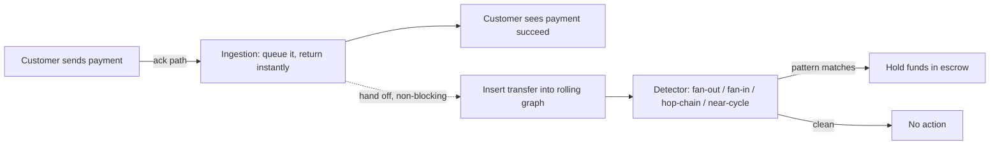
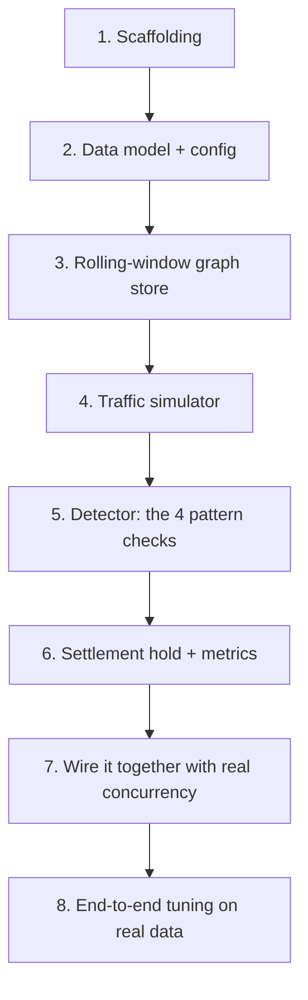
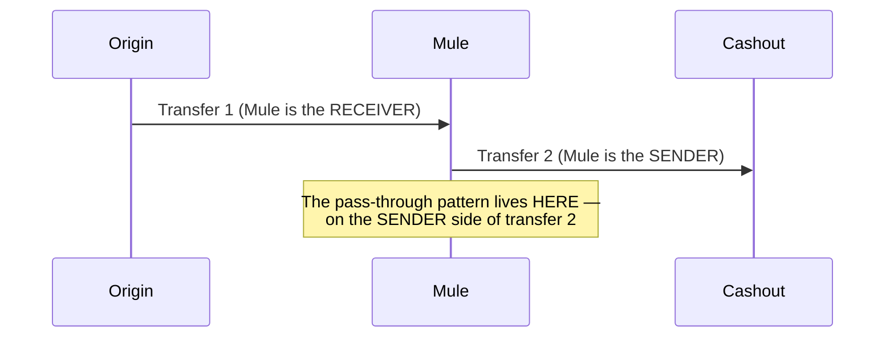

# Case Scenario #1: Stopping a Real-Time Fraud Ring Without Slowing Down Payments

Here's a scenario worth building for, not just talking about: a payment
platform's fraud model checks each transaction in about two seconds. An
attacker splits ₹18 crore across roughly 10,000 mule accounts — accounts used
to receive and quickly forward stolen money — in transfers too small and too
normal-looking for that model to catch. By the time anyone notices, the money
is gone.

This is **Case Scenario #1** in an ongoing series: I take a real engineering
scenario and actually build the system that solves it, instead of leaving it
as a whiteboard discussion. This entry covers Phase 0 of a real-time fraud
detection system — from a design doc to a working prototype, the two real
bugs I found along the way, and the numbers it produced after tuning.

## TL;DR

- I built the prototype in 8 small chunks, and every chunk had to pass real,
  automated tests — happy path and failure cases — before I moved to the next one.
- Two real bugs showed up because a test actually **failed**, not because I
  spotted them reading the code.
- Final result: the one fraud ring I injected into test traffic got caught,
  false positives dropped from 6 to **0** after tuning, and detection added
  **+0.0001 milliseconds** to a normal payment — statistically zero.
- The core idea: keep a short-term, in-memory map of who's been paying whom,
  and check it in the background while the payment itself goes through instantly.
- This is the first entry in a case-scenario series — each one takes a real
  problem and builds the actual system for it.

## The problem, for whoever's signing off on this

**For whoever's signing off on this:** the naive fixes don't work. Checking a
customer's full transaction history on every payment is too slow — it can
crash the system under real load. Blocking any account that sends money to
many people also fails, because that's exactly what a legitimate payroll
run looks like too.

The fix has to catch a fraud *pattern* spread across many small transfers,
without slowing down a single real customer's payment. That's the whole bet
this prototype is testing.

## How the real-time fraud detection system works

Every payment gets written into a small, in-memory graph: accounts are nodes,
transfers are edges. That graph only remembers the last few minutes of
activity — old transfers get dropped automatically, so memory never grows out
of control. A detector checks each new transfer against this recent history
for suspicious shapes: one account suddenly paying many people (**fan-out**),
one account suddenly receiving from many people (**fan-in**), money passing
through an account too fast (**hop-chain**), or money looping back to where
it started (**near-cycle**).

The customer-facing payment never waits for any of this. It's acknowledged
instantly, while the detection work happens in a separate background task.



The customer only ever touches the top row. Everything below the dotted line
runs concurrently, on its own time.

## Building it, chunk by chunk

I broke the build into 8 small pieces so each one could be finished and
verified in one sitting, instead of writing the whole thing and hoping it
worked:



Every chunk got both **happy-path tests** (does it work when everything's
normal?) and **negative tests** (does it correctly refuse to fire when it
shouldn't?) before I let myself call it done.

## Bug #1: the detector was watching the wrong account

Here's the real bug. A fraud ring works like this: money goes from an origin
account, through several mule accounts, and out to a cash-out account. A mule
account receives money and forwards it within seconds — that fast
receive-then-forward is exactly what the hop-chain check is supposed to catch.



My first version only checked this pattern on the **receiver** of each new
transaction:

```python
if check_hop_chain(receiver_stats, max_hop_chain_ms):
    reasons.append(RingReason.HOP_CHAIN)
```

This line only matters for half the picture: when a mule forwards money
onward, that mule is the *sender* of that transaction, not the receiver. My
test for "does the detector catch a full ring end-to-end" failed —
`rings_caught` came back as 0 when it should have been 1.

<details>
<summary>See the actual failing test output</summary>

```
test_small_ring_is_caught_end_to_end_when_thresholds_are_met FAILED

    assert metrics.rings_injected == 1
>   assert metrics.rings_caught == 1
E   assert 0 == 1
E    +  where 0 = RunMetrics(rings_injected=1, rings_caught=0,
         rings_missed=1, false_positives=0, ...).rings_caught
```

The ring was there (`rings_injected == 1`), but `rings_caught` stayed 0 —
proof the detector ran and still missed it, not that the test setup was broken.
</details>

The fix was checking both sides:

```python
if check_hop_chain(sender_stats, max_hop_chain_ms):
    reasons.append(RingReason.HOP_CHAIN)
if check_hop_chain(receiver_stats, max_hop_chain_ms):
    reasons.append(RingReason.HOP_CHAIN)
```

Checking both the sender and the receiver catches the pass-through pattern
no matter which side of the transaction the mule is on. I re-ran the full
test suite after this fix — all 55 tests still passed, so nothing else broke.

## Bug #2: paying a friend back isn't fraud

The near-cycle check looks for money looping back to where it started — A
pays B, then B pays A back. My first version flagged this if it happened
**anywhere in the 5-minute window**, with no time limit at all.

That's a real problem: two friends who pay each other back for small things
will trigger this by pure chance. I ran a real threshold sweep — not a guess —
and traced the remaining false positives straight to this check. Adding a
time limit, the same "fast means suspicious" logic the hop-chain check
already used, fixed it:

```python
def check_near_cycle(stats, max_span_ms=config.MAX_NEAR_CYCLE_MS):
    # only counts as suspicious if the round trip happens within max_span_ms
    ...
```

A round trip that happens within seconds looks like laundering. A round trip
that happens days later looks like two people splitting a dinner bill.

## The numbers, after tuning

**For whoever's signing off on this:** these are the numbers that actually
matter.

- **1 of 1** injected fraud rings caught
- **False positives: 0**, down from 6 before tuning
- **Ack latency delta: +0.0001 milliseconds** — the real, measured difference
  between running the detector and not running it at all
- **58 of 58** automated tests passing

That last latency number is the one I care about most. It's not an assumption
baked into the design — I built a mode that turns detection off entirely, ran
both versions, and measured the actual gap. It's close enough to zero that a
real customer would never notice this running.

## What this means for your team

A real-time fraud detection system that adds real latency to every payment is
a system nobody will let you ship. A system that only gets validated by reading the
code, instead of running it, is one where bugs like the hop-chain mistake
above ship to production. The discipline here — small chunks, real tests,
real tuning data instead of guesses — is what turns "I think this works" into
"here are the numbers that prove it."

None of this proves the hardest business assumption yet: whether a real
payment network actually gives you a usable window of time to freeze
suspicious money before it's gone. That's simulated here, not proven — a loose
thread this scenario leaves open.

## What's next in the series

Each entry in this series is a different real scenario, with the actual
system built to match. If enough people want to see this specific scenario's
open thread closed — the settlement-window question above, and the business
case for pitching this internally — I'll make that a follow-up. Otherwise,
next up is a new case scenario entirely.

If you've built something similar, or you think the near-cycle bug above is
obvious in hindsight, I'd genuinely like to hear about it.

---

**Alternate titles:**
1. "Case Scenario #1: I Built a Real-Time Fraud Detector and Found Its Bugs With Failing Tests, Not Code Review"
2. "Catching a Fraud Ring in Milliseconds: A Real-Time Fraud Detection System, Built and Tested"
3. "Real Scenario, Real System: Building a Fraud Ring Detector From Scratch"

**Meta description (155 chars):**
Case Scenario #1: a real-time fraud detection system, built in 8 tested chunks — two real bugs, a threshold sweep, +0.0001ms latency cost.

**Tags:** case scenario series, real-time fraud detection, mule account detection, fraud ring detection, test-driven development, Python asyncio, system design, software architecture
