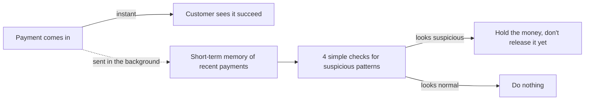
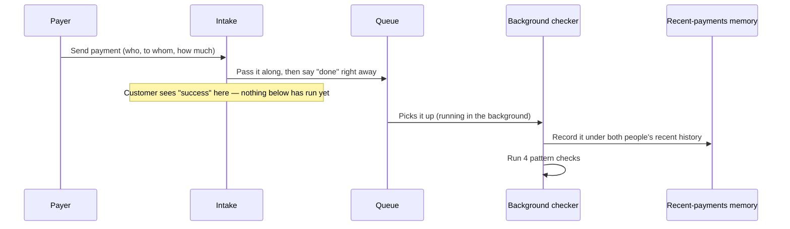
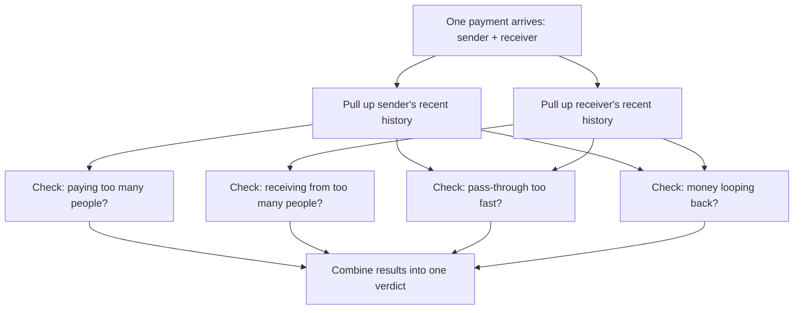

# How We Catch Fraud Rings in Real Time — Without Slowing Down Any Payment

I already wrote about two real bugs we found while building this fraud
detector. This time I want to explain the whole thing simply: the business
problem, how the system actually works, and why we picked every piece of it
for speed, not just for being correct.

This is a real, working prototype — not just a plan. It passed 58 automated
tests. It caught a fake fraud ring we built to test it. And it added
**0.0001 milliseconds** of delay to a normal payment. That's close enough to
zero that no customer would ever notice. Here's how.

## TL;DR

- **The problem:** a fraud check that looks at one payment at a time can't
  see fraud that's spread across thousands of tiny payments.
- **The fix:** keep a short memory of who paid whom recently, and check it
  in the background — while the payment itself still goes through instantly.
- **The result:** caught the test fraud ring, false alarms dropped from 6 to
  0 after tuning, and 58 out of 58 tests passed.
- **The part most people skip:** every piece of this — how we store money,
  how we store time, how we store the list of payments — was picked because
  it's the fastest safe option, not just a working one.
- **What's still open:** this proves the idea works. It doesn't yet prove
  that real banks will give us the time window we're assuming we have.

## The problem: fraud that hides in the shape of money, not in any one payment

**For whoever's signing off on this:** here's the scenario we're solving.

A payment platform checks each transaction for fraud in about two seconds.
That's already slow. If we add more checks per payment, customers start to
notice the delay.

An attacker uses that limit against us. Instead of one big suspicious
payment, they split the money into thousands of small transfers. Each one
passes through a "mule account" — an account used only to receive stolen
money and quickly pass it along. No single transfer looks unusual. The fraud
is only visible if you look at the whole pattern of payments together — and
a system that checks one payment at a time can never see that pattern.

Two easy-sounding fixes don't actually work:

- **Check a customer's whole payment history every time they pay.** This
  gets slower and slower as the history grows, and it can crash the system
  under real traffic.
- **Block any account that pays too many people too fast.** This also
  blocks normal things, like a company paying its whole staff on payday.

Here's the opening we actually have. In India's UPI (Unified Payments
Interface) system, a payment *looks* instant to both people involved. But the
money isn't fully, finally settled between the two banks right away — there's
a real, short gap while that settlement finishes. That gap is a window where
we can still catch and hold suspicious money, before it's gone for good. This
project tests whether a cheap, background check can actually use that window.

## How it works: watch the pattern, don't slow down the payment

The system splits into two paths. They never wait on each other.



The top row is the only part a customer ever feels. Everything below the
dotted line happens after the customer has already moved on. That's the main
idea: checking for fraud can take as long as it needs to, because it was
never something the customer had to wait for in the first place.

## Following one payment through the system



Each payment gets stored twice — once under the sender's recent history, once
under the receiver's. We never build one giant list of every payment ever
made. Each account only remembers its own short, recent slice. And when we
check for fraud, we only ever look at the two accounts in that one payment,
never the whole system.

The four checks we run:

- **Paying too many people** (fan-out) — one account suddenly paying many
  different people, like the start of a mule network.
- **Receiving from too many people** (fan-in) — one account suddenly
  collecting money from many different people, like a cash-out account.
- **Pass-through** (hop-chain) — money arrives and gets forwarded again
  within seconds, which is exactly what a mule account does.
- **Money looping back** (near-cycle) — money that goes out and quickly
  comes back to where it started.

If any of these fire, we flag the payment and write down exactly which
accounts and which transfers caused it — not just a score, but a real reason
someone can check later.

## How the code checks all 4 rules on one payment

Here's the part people usually picture as four separate steps, each one
slower than the last. In the actual code, it's one function, and it's fast
because of what it *doesn't* have to do.



The key detail: every check reads from the **same two small lists** — the
sender's recent payments and the receiver's recent payments. Nothing here
calls a database, waits on a network, or looks at any other account. That's
why running four checks feels instant instead of four times slower than
running one.

In plain terms, this is what the code does, one step at a time:

```python
def detect(graph, payment):
    sender_history = graph.accounts[payment.sender]
    receiver_history = graph.accounts[payment.receiver]

    reasons = []

    if paying_too_many_people(sender_history):
        reasons.append("fan-out")

    if receiving_from_too_many_people(receiver_history):
        reasons.append("fan-in")

    if passes_through_fast(sender_history) or passes_through_fast(receiver_history):
        reasons.append("hop-chain")

    if money_loops_back(sender_history) or money_loops_back(receiver_history):
        reasons.append("near-cycle")

    return "flagged" if reasons else "clean", reasons
```

A few things worth noticing about this:

- **It only ever looks at two accounts** — the sender and the receiver of
  this one payment. It never scans every account in the system.
- **Pass-through and money-looping-back get checked on *both* sides**, not
  just the receiver. A mule account shows the suspicious pattern as the
  *sender* when it forwards stolen money along — checking only the receiver
  side would miss exactly that case. (This was bug #1 from my earlier post.)
- **All four checks run one after another, not in parallel threads** — and
  that's fine, because each one is just a quick look at a short list already
  sitting in memory. There's nothing slow to wait for, so doing them one
  after another costs almost nothing.
- **One payment gets one verdict.** All four results get combined into a
  single answer — flagged or clean — along with the exact reasons, so
  whoever reviews it later sees all four checks' answers at once, not four
  separate reports to piece together.

## Why every piece of this was built for speed

This is the part most write-ups skip: the actual choices behind the scenes,
and why each one is the fast option, not just a working one.

<table>
<tr><th>What we had to store</th><th>What we used</th><th>What we didn't use</th><th>Why it's faster</th></tr>
<tr><td>Money amounts</td><td>Plain whole numbers (smallest coin/paisa unit)</td><td>A "precise decimal" number type</td><td>Whole-number math is simple and fast. We don't need the extra precision machinery, because there's no currency conversion or tax math happening here.</td></tr>
<tr><td>Each account's recent payments</td><td>A list that's quick to add to <em>and</em> quick to trim from both ends</td><td>A plain list, trimmed from the front</td><td>Adding a new payment is instant either way. But removing an old one — which happens constantly — is instant with the right list, and gets slower and slower with a plain one as it grows.</td></tr>
<tr><td>How many different people an account paid</td><td>A running count that updates itself as payments age out</td><td>Re-checking the whole history every time</td><td>Updating a running count is instant. Re-scanning the full recent history every time a payment expires gets slower the more payments there are.</td></tr>
<tr><td>Looking up an account</td><td>A dictionary that creates a blank record automatically for a new account</td><td>A dictionary plus an extra "does this account exist yet?" check</td><td>Removes an extra step from the busiest part of the code. A brand-new mule account costs exactly the same to look up as one we've seen a thousand times.</td></tr>
<tr><td>Time</td><td>Plain whole numbers (a made-up clock, but one that still reads like a real date)</td><td>Real calendar/clock objects, real wall-clock waiting</td><td>Comparing two whole numbers is instant. It also means every test run behaves exactly the same way every time, instead of depending on how fast the real clock happens to tick.</td></tr>
<tr><td>Currency rules for 200+ countries</td><td>A trusted, built-in lookup, done once when the program starts</td><td>A hand-written list of countries and currencies</td><td>We pay the lookup cost once, at startup. Every payment after that costs nothing extra, and we never have to remember to update a list by hand.</td></tr>
<tr><td>How much history to check</td><td>Only the last few minutes, and nothing older</td><td>Checking a payment's entire history, forever</td><td>Memory and speed stay the same no matter how long the system runs or how big it gets. Checking full history gets slower and slower as the platform grows.</td></tr>
<tr><td>How payments get checked</td><td>Say "done" to the customer first, check for fraud after, in the background</td><td>Make the customer wait until the fraud check finishes</td><td>The customer's wait time never depends on how much work the fraud check does. That's guaranteed by how the system is built, not just something we hope is true.</td></tr>
</table>

Two things here are honestly not the fastest they could be, and that's worth
saying out loud:

- Counting "how many different people did this account pay" still rescans
  the account's short recent history instead of keeping its own running
  count. It's cheap, because that history is always short — just not
  instant the way some of the other counts are.
- We never remove an account from memory completely, even after it stops
  being active — only its old payments get trimmed. On a very long run with
  many one-time accounts, that list would slowly grow. Not a problem yet at
  this size, but worth knowing.

Pointing out what isn't fully optimized matters as much as showing off what
is. A write-up that claims everything is perfect is usually hiding the parts
nobody actually checked.

## The big decisions, and why we made them

The table above covers the small choices. These are the bigger ones — the
calls that shaped the whole system. For each one, here's what we picked,
what we said no to, and what we gave up by choosing it.

<table>
<tr><th>Decision</th><th>What we chose</th><th>What we said no to, and why</th><th>What we gave up</th></tr>
<tr><td>How much history to check</td><td>Only a short recent window, kept in memory</td><td>Checking a customer's full payment history every time — too slow, and it gets worse as the platform grows. Also: blocking anyone who pays too many people — that blocks normal payroll too.</td><td>Fraud that's spread out over hours or days instead of minutes wouldn't be caught by this version.</td></tr>
<tr><td>When to check for fraud</td><td>Say "done" to the customer right away, check in the background, only ever hold money — never cancel the payment outright</td><td>Making the payment wait for the fraud check — the existing check already takes two seconds; adding more would be noticeable.</td><td>If the fraud check finishes too late, after the money's window has closed, that's a miss. We count it honestly instead of hiding it.</td></tr>
<tr><td>How smart the fraud check is</td><td>Four simple, clear rules anyone can read and explain</td><td>A more advanced, self-learning model — a reasonable next step, but it needs a lot of real labeled examples and proper testing first.</td><td>Simple rules might miss sneakier fraud patterns that a smarter model would catch.</td></tr>
<tr><td>How the system is deployed</td><td>One single program, with a background task running inside it</td><td>Splitting it into several separate services talking over the network — what we're testing is the idea, not how it's deployed.</td><td>Doesn't test real network slowdowns or failures between separate services.</td></tr>
<tr><td>What data to test with</td><td>Made-up, labeled payment data we built ourselves</td><td>A real public fraud dataset — convenient, but we wouldn't know for certain which transfers are fraud and which just look similar.</td><td>The test data is made up, not pulled from real-world traffic.</td></tr>
<tr><td>How time is tracked</td><td>A made-up clock that still reads like real dates</td><td>Using the real clock — a 5-minute window would mean actually waiting 5 minutes every time we test it.</td><td>Doesn't capture real-world timing hiccups that might show up under real traffic.</td></tr>
<tr><td>How currencies are handled</td><td>A trusted, built-in currency lookup</td><td>A hand-written list of countries and their currencies — fine for 3 countries, not for 200+, and it goes stale over time.</td><td>Adds one outside tool to the project. Worth it compared to maintaining that list by hand forever.</td></tr>
</table>

Every option we said no to was a real choice someone could have made
instead. Writing down why it lost is what makes a decision easy to revisit
later — by a teammate, an auditor, or me in six months, after I've forgotten
why.

## What broke, and what the real numbers say

Two real bugs showed up while testing this. One check only looked at the
receiving side of a payment, so it missed a mule account acting as the
*sender* when it forwarded money along. Another check had no time limit at
all, so it flagged two friends paying each other back as if it were fraud.
Both are covered in detail in my earlier post. Both were caught because a
test actually failed — not because someone spotted them while reading code.

<details>
<summary>The numbers after fixing both bugs</summary>

- Fraud rings we injected: 1, fraud rings caught: 1
- False alarms: 0, down from 6 before we fixed the bugs above
- Extra delay added to a normal payment: **0.0001 milliseconds**
- Tests passing: 58 out of 58

</details>

That delay number matters most to a payments team. It's not a guess. We
built a version with the fraud check turned off completely, ran both
versions, and measured the real difference.

One honest note: the test above moved about ₹18 lakh through 12 mule
accounts — a small, easy-to-check version of the pattern, not the full-scale
version with thousands of accounts that this system is meant to eventually
catch. This step was about proving the idea works, not about producing a
final, production-ready number yet.

## What this means for your team

Every small choice above adds up to one simple business fact: this system
never makes a customer's payment slower, no matter how hard the fraud check
is working. That's not something we hope is true — it's built into how the
system works.

This real-time fraud detection system is deliberately simple under the hood
— plain, well-known tools, no extra database, no outside service. That's a
cost decision too, not just a technical one. Nothing here needs licensing,
hosting, or a dedicated team to keep running, and it stays fast by staying
small, not by adding more infrastructure as it grows.

What it doesn't answer yet is the harder question: does a real, usable
window actually exist with real banks, with real cooperation, to place a
hold on money in time? That's not something this prototype can prove on its
own. That's the next conversation.

## Close

What stuck with me most is how much of "is this fast" came down to small,
boring choices nobody would normally put in a design document — which list
type to use, which counter to keep. Each one looks tiny on its own. At real
payment volume, they're the difference between a system that stays fast and
one that quietly slows down as it grows.

If you've built something like this and made different calls, I'd like to
hear about it.

---

**Alternate titles:**
1. "The Simple Choices Behind a Real-Time Fraud Detection System (and Why Each One Is Fast)"
2. "How a Short-Term Memory of Payments Catches Mule Accounts Without Slowing Anyone Down"

**Meta description (156 chars):**
A simple explainer on real-time fraud detection: the business problem, how it works, and why every choice behind it was made for speed.

**Tags:** real-time fraud detection, fraud detection explained, mule account detection, UPI payments, system design basics, Python asyncio, simple explanations
